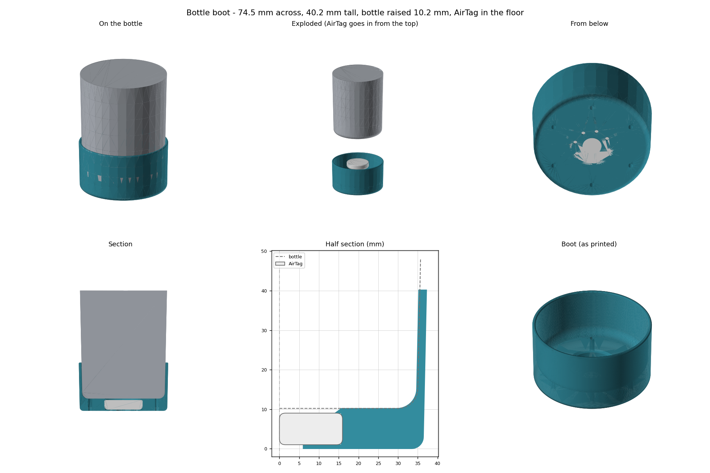
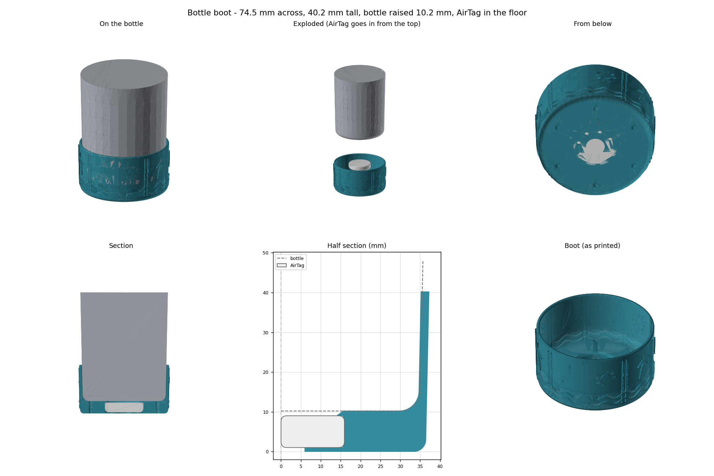
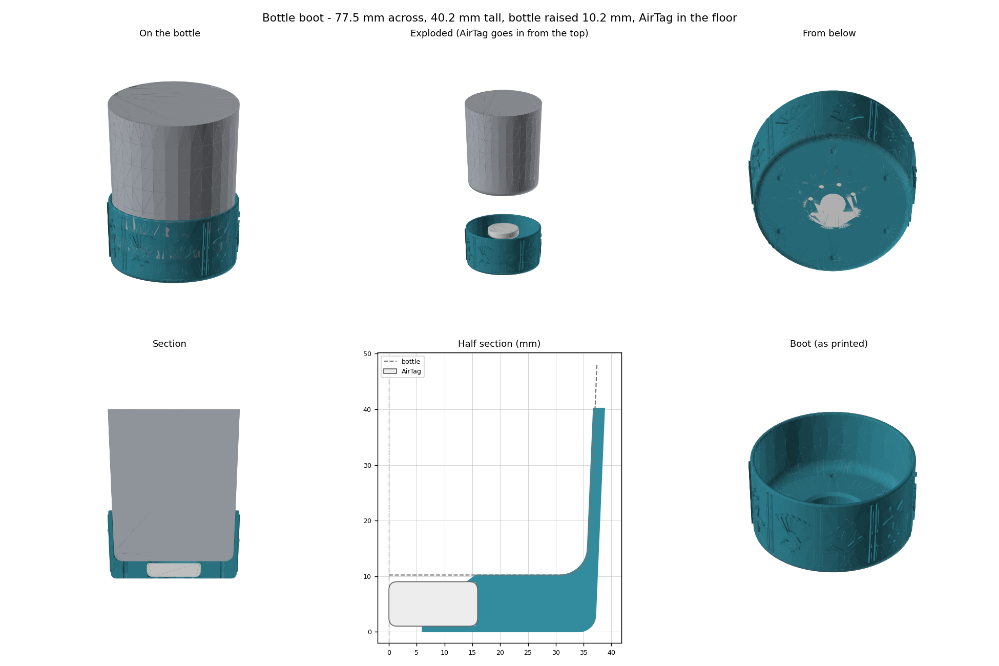

# Bottle boot with AirTag pocket

A parametric, 3D-printable TPU boot for the bottom of an Owala FreeSip water
bottle. A hidden pocket in the floor holds an Apple AirTag. It protects the
base, stops the clank on hard surfaces, and makes the bottle findable.

Everything is generated with [CadQuery](https://github.com/CadQuery/cadquery)
from `params.json` plus a per-bottle profile, so a new bottle is a folder of
measurements, not a new model.

| Owala FreeSip Sway 30 oz | Sway 30 oz, "surf" texture | FreeSip Tumbler 40 oz, "cabana" texture |
|---|---|---|
|  |  |  |

## Design

- **Boot:** a cup that follows the bottle's taper, slightly undersized
  (`FIT_SQUEEZE`) so the TPU stretches on and grips. The Sway widens towards
  the lid, so the boot tightens as it is pushed on.
- **AirTag pocket:** pressed in from inside the boot, held by a lip with a
  45° lead-in. With the bottle in, nothing presses on the AirTag.
- **Holes:** a push hole to pop the AirTag out, sound holes for its speaker,
  and drain holes for washing.
- **Texture (optional):** a raised pattern round the outside wall. The inside
  is untouched, so the fit is the same as the plain boot. The motifs are
  original, in the spirit of the bottles' graphics.

## Print it

- **Material:** TPU 90A, floor on the bed, open side up, no supports.
- **Tested on:** Bambu Lab A1, 0.4 mm nozzle, textured PEI. 220 °C, 5 walls,
  solid floor, 0.8 mm retraction, timelapse off (it causes stringing in TPU).
  About 6 h and 59 g per boot.
- **Files:** each profile folder has a ready-to-slice Bambu Studio project
  (`*_boot.3mf`) and a fit-test plate in `fit_test/`. The full-resolution boot
  STLs are 80 to 100 MB each, so they're on the
  [Releases page](../../releases) instead of in the repo.

Print the fit test first if your bottle isn't one of the profiles here.

## Generate

```bash
python -m venv venv
venv\Scripts\pip install -r requirements.txt
venv\Scripts\python generate.py                       # every profile
venv\Scripts\python generate.py bottles/<name>         # one profile
venv\Scripts\python fit_test.py bottles/<name>         # fit test pieces
venv\Scripts\python make_3mf.py bottles/<name>         # Bambu Studio project
```

New bottle: copy `bottles/owala_freesip_sway_30oz`, rename it, and update
`bottle.json` with your measurements. All lengths are in mm.

## Status

The plain Sway 30 oz boot is printed and fits. The 40 oz Tumbler profile is
built from published sizes and not printed yet.

Not affiliated with or endorsed by Owala.

## License

[MIT](LICENSE)
